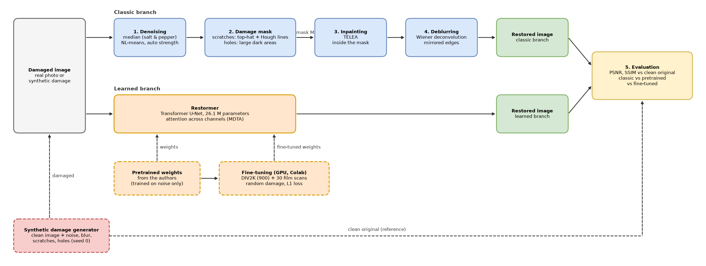

# Image Restoration

Restoration of damaged images (noise, scratches, blur, missing regions) using image processing techniques.

## Project Description

Old and damaged photographs often show several defects at once: noise, scratches, blur and missing regions. This project restores such damage in a single grayscale image: the input is the damaged image and the output is the restored image, while colour images, colorization and video are out of scope.

Two branches start from the same damaged image and are compared on the same test images:

- **Classic pipeline** – image processing methods applied in a fixed order: denoising (median / NL-means with automatic strength), damage-mask detection (white top-hat filtered by Hough lines for scratches, connected components for missing regions), OpenCV inpainting (TELEA) and Wiener deblurring.
- **Learned branch** – the pretrained [Restormer](https://github.com/swz30/Restormer) (grayscale blind denoising, 26.1 M parameters), verified on BSD68 σ=25 (29.51 dB, same as the paper) and then fine-tuned on our four kinds of damage (random synthetic damage on DIV2K + real damaged film scans).

Results are measured with PSNR and SSIM on images with synthetic damage, where the clean original is known. With each defect applied separately, the classic pipeline raises mean PSNR by +7.28 dB for Gaussian noise (NL-means), +17.51 dB for salt & pepper (median), +3.88 dB for motion blur (Wiener), +12.22 dB for missing regions (TELEA) and +11.01 dB for scratches with the detected mask, versus +22.63 dB with the true mask, which makes scratch detection the main open problem (IoU 0.33–0.44 with the true mask).

## State of the Art

Analysis of similar articles / applications / projects from the last 5 years.

### Overview

| No. | Author(s) / Year | Title | Application / Domain | Technologies used | Results |
|-----|------------------|-------|----------------------|-------------------|---------|
| 1 | Zamir et al., 2022 | [Restormer](https://arxiv.org/abs/2111.09881) | Denoising, deblurring | PyTorch | Real noise (SIDD): 40.02 dB; motion blur (GoPro): 32.92 dB PSNR (Tab. 6, 2) |
| 2 | Potlapalli et al., 2023 | [PromptIR](https://arxiv.org/abs/2306.13090) | All-in-one restoration | PyTorch | BSD68 σ=25: 31.31 dB all-in-one vs. 31.71 dB single-task (Tab. 1, 4) |
| 3 | Suvorov et al., 2022 | [LaMa](https://arxiv.org/abs/2109.07161) | Inpainting | PyTorch, 8× V100 | FID 2.21, LPIPS 0.135 (lower is better), Places, wide masks (Tab. 1) |
| 4 | Kuo et al., 2022 | [Old photo damage detection](https://pmc.ncbi.nlm.nih.gov/articles/PMC9656350/) | Scratch detection | NVIDIA 2070 GPU | F1 0.873 vs. 0.831 for Wan et al., 18 real photos (Tab. 2) |
| 5 | Ivanova et al., 2023 | [Film damage simulation](https://arxiv.org/abs/2302.10004) | Dust & scratch removal | OpenCV, NumPy, P100 GPU | 39.6 dB with LaMa + their masks vs. 28.89 dB Photoshop filter, 44 real scans (Tab. 4) |

### Analysis

| No. | Methodology / Approach | Limitations | Additional comments |
|-----|------------------------|-------------|---------------------|
| 1 · Restormer | Encoder-decoder Transformer; attention computed across channels (MDTA) so cost stays manageable on large images, gated feed-forward blocks (GDFN), training on progressively larger patches (Sec. 3) | Needs paired clean/damaged training data and a separately trained model per task; the paper has no limitations discussion (Sec. 5) | Quality reference for my steps 1 and 4: run its pretrained denoising/deblurring models on my σ=25 and motion-blur test images and compare with NL-means (+7.28 dB) and Wiener (+3.88 dB) |
| 2 · PromptIR | UNet-style Transformer plus prompt blocks that encode the type of degradation, so one network handles noise, rain and haze without being told which one (Sec. 3) | All-in-one costs 0.40 dB against the single-task model on BSD68 σ=25 (Tab. 1 vs. 4); blur, scratches and missing regions are not among its tasks | Supports keeping separate, specialised steps in my pipeline instead of one model for all four defects |
| 3 · LaMa | Inpainting network with fast Fourier convolutions (image-wide receptive field), a high-receptive-field perceptual loss and large training masks (Sec. 2) | Needs the mask as input, it does not find the damage; struggles with strong perspective distortion (Sec. 5) | Candidate to replace OpenCV TELEA/NS in step 3 for large missing regions; like my pipeline, its quality depends on the mask from step 2 |
| 4 · Kuo et al. | U-Net with residual dense blocks detects damaged areas; trained on 170 hand-labelled old photos plus synthetic damage; the mask is then passed to existing inpainting methods (Sec. 2, 3.3) | Small test set (18 photos); detection failures shown (Fig. 11, Sec. 3.3); no PSNR/SSIM for the final restored photos; no code released | Same detect-then-inpaint split as my steps 2–3; my top-hat mask reaches only IoU 0.33–0.44 (+11.01 dB vs. +22.63 dB with the true mask), so step 2 is what I improve next |
| 5 · Ivanova et al. | Statistical model of real film dust and scratches generates synthetic damage; realism checked with a human study; 8 restoration methods compared on 44 real 4K scans with expert restorations (Sec. 3–5) | Film scans, not printed photos; damage segmentation is still weak (IoU 0.256, Tab. 3) | Detect-then-inpaint (LaMa + masks, 39.6 dB) beats a single filter (28.89 dB) on real damage, which supports my mask → inpaint order; their damage generator could replace my random-line scratches |

**References**

1. S. W. Zamir et al., *Restormer: Efficient Transformer for High-Resolution Image Restoration*, CVPR 2022. [arXiv:2111.09881](https://arxiv.org/abs/2111.09881) · [code](https://github.com/swz30/Restormer)
2. V. Potlapalli et al., *PromptIR: Prompting for All-in-One Blind Image Restoration*, NeurIPS 2023. [arXiv:2306.13090](https://arxiv.org/abs/2306.13090) · [code](https://github.com/va1shn9v/PromptIR)
3. R. Suvorov et al., *Resolution-robust Large Mask Inpainting with Fourier Convolutions*, WACV 2022. [arXiv:2109.07161](https://arxiv.org/abs/2109.07161) · [code](https://github.com/advimman/lama)
4. T.-Y. Kuo et al., *Learning-Based Image Damage Area Detection for Old Photo Recovery*, Sensors 22(21), 8580, 2022. [PMC9656350](https://pmc.ncbi.nlm.nih.gov/articles/PMC9656350/)
5. D. Ivanova et al., *Simulating analogue film damage to analyse and improve artefact restoration on high-resolution scans*, Computer Graphics Forum (Eurographics 2023). [arXiv:2302.10004](https://arxiv.org/abs/2302.10004) · [code](https://github.com/daniela997/FilmDamageSimulator)

- **Application / Domain** – domain in which the described solution is applied (e.g., face recognition, augmented reality).
- **Technologies used** – technologies / hardware used in the project (e.g., OpenCV, TensorFlow, ZED stereo cameras).
- **Methodology / Approach** – description of the method used in the project.
- **Results** – main results obtained (metrics used for evaluation).
- **Limitations** – limitations encountered in research or implementation.
- **Additional comments** – observations on relevance to the current project; suggestions for improving the methodology.

## Proposed Architecture



### Components

- **Damaged image** – input: a real damaged photo, or a clean image damaged by the generator.
- **1. Denoising** – removes noise first (median filter for salt & pepper; bilateral / NL-means for Gaussian noise).
- **2. Damage mask detection** – builds the binary mask of damaged pixels (scratches via white top-hat + threshold; missing regions as missing pixels).
- **3. Inpainting** – fills the masked pixels from their surroundings (OpenCV TELEA or Navier-Stokes).
- **4. Deblurring** – reverses blur with Wiener deconvolution, using a known or estimated blur kernel (PSF).
- **Restored image** – output of the pipeline.
- **5. Evaluation** – PSNR and SSIM against the clean original when one exists; no-reference metrics (NIQE / BRISQUE) and visual inspection for real photos.
- **Synthetic damage generator** – adds noise, blur, scratches and holes to clean images with a fixed seed, so results can be measured and reproduced.
- **Learned branch** – the same damaged image goes through the pretrained Restormer and through the Restormer fine-tuned on our damage; all three outputs are compared with the same metrics.

## Results

Classic pipeline, each defect applied separately (mean PSNR in dB over 4 test images, `src/evaluate.py`):

| Defect | Damaged | Restored | Method |
|---|---:|---:|---|
| Gaussian noise σ=25 | 21.35 | 28.63 | NL-means |
| Salt & pepper 5% | 17.27 | 34.78 | median 3×3 |
| Motion blur 9 px | 26.84 | 30.72 | Wiener |
| Scratches (detected mask) | 17.25 | 28.26 | TELEA |
| Missing regions | 28.25 | 40.47 | TELEA |

Classic pipeline vs pretrained Restormer (first 20 BSD68 images, same damage for all methods, `src/compare.py`):

| Test set | Damaged | Classic pipeline | Pretrained Restormer |
|---|---:|---:|---:|
| Gaussian noise σ=25 | 20.49 dB | 25.17 dB | **29.71 dB** |
| All four defects combined | 20.53 dB | **23.91 dB** | 22.68 dB |

The pretrained Restormer wins on noise but was trained only on noise, so it leaves scratches and missing regions; this is why it is fine-tuned on our damage (a 150-step CPU test already gives +0.9 dB, the full fine-tuning runs on a GPU in Google Colab).

## How to run

```
pip install -r requirements.txt          # plus PyTorch (see the comment in requirements.txt)
python src/download_data.py              # BSD68, old photos, film scans, DIV2K (train set: 3.5 GB)
python src/restore.py image.png --blur 9 # classic pipeline on one image, every step saved in results/restore/
python src/evaluate.py                    # classic methods on each defect -> results/results.md
python src/test_restormer.py             # pretrained Restormer on BSD68 sigma=25 (needs models/gaussian_gray_denoising_blind.pth)
python src/run_restormer.py image.png --noise 25   # Restormer on one image
python src/finetune_restormer.py         # fine-tuning on our damage (GPU recommended)
python src/compare.py                    # classic vs pretrained vs fine-tuned -> results/compare.md
```

Fine-tuning on a free GPU: open [notebooks/finetune_colab.ipynb](notebooks/finetune_colab.ipynb) in Google Colab, choose a T4 GPU and run all cells.

## Demo

Screen recording (4:54) of the pretrained Restormer running on BSD68 images with Gaussian noise (PSNR before / after) and on real old photos: [docs/demo_restormer.mp4](docs/demo_restormer.mp4).

Intermediate presentation (PDF): [docs/presentation.pdf](docs/presentation.pdf).
