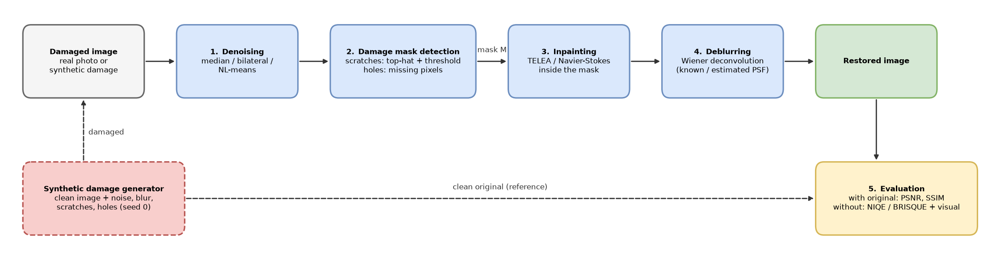

# Image Restoration

Restoration of damaged images (noise, scratches, blur, missing regions) using image processing techniques.

## Project Description

_TODO: short description of the project — what problem it solves, what kind of damage it handles, input/output._

## State of the Art

Analysis of similar articles / applications / projects from the last 5 years.

| No. | Author(s) / Year | Title of the article / project | Application / Domain | Technologies used | Methodology / Approach | Results | Limitations | Additional comments |
|-----|------------------|--------------------------------|----------------------|-------------------|------------------------|---------|-------------|---------------------|
| 1 | | | | | | | | |
| 2 | | | | | | | | |
| 3 | | | | | | | | |
| 4 | | | | | | | | |
| 5 | | | | | | | | |

- **Application / Domain** – domain in which the described solution is applied (e.g., face recognition, augmented reality).
- **Technologies used** – technologies / hardware used in the project (e.g., OpenCV, TensorFlow, ZED stereo cameras).
- **Methodology / Approach** – description of the method used in the project.
- **Results** – main results obtained (metrics used for evaluation).
- **Limitations** – limitations encountered in research or implementation.
- **Additional comments** – observations on relevance to the current project; suggestions for improving the methodology.

## Proposed Architecture

### Components

- **Damaged image** – input: a real damaged photo, or a clean image damaged by the generator.
- **1. Denoising** – removes noise first (median filter for salt & pepper; bilateral / NL-means for Gaussian noise).
- **2. Damage mask detection** – builds the binary mask of damaged pixels (scratches via white top-hat + threshold; missing regions as missing pixels).
- **3. Inpainting** – fills the masked pixels from their surroundings (OpenCV TELEA or Navier-Stokes).
- **4. Deblurring** – reverses blur with Wiener deconvolution, using a known or estimated blur kernel (PSF).
- **Restored image** – output of the pipeline.
- **5. Evaluation** – PSNR and SSIM against the clean original when one exists; no-reference metrics (NIQE / BRISQUE) and visual inspection for real photos.
- **Synthetic damage generator** – adds noise, blur, scratches and holes to clean images with a fixed seed, so results can be measured and reproduced.